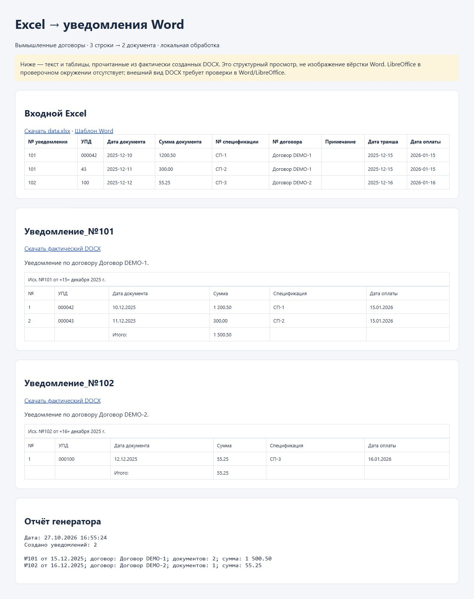

# Генератор уведомлений из Excel и Word

Локальная Python-утилита для подготовки уведомлений по шаблону Word. Группирует строки Excel по договору и дате транша, формирует таблицу документов и рассчитывает итоговую сумму.

## Возможности

- Отдельный DOCX для каждой пары «договор + дата транша».
- Проверка обязательных полей, дат, сумм и структуры шаблона.
- Подстановка меток, в том числе разделённых форматированием Word.
- Текстовый отчёт и защита от перезаписи существующих уведомлений.
- Вымышленные примеры и пять штатных тестов.

**Стек:** Python, pandas, openpyxl, python-docx, unittest.

## Запуск на демонстрационных данных

```sh
cd notification-generator-github/notification-generator
python -m venv .venv
# Активируйте .venv для вашей операционной системы.
python -m pip install -r requirements.txt
python examples/make_demo.py
python notification_generator.py examples/generated/data.xlsx examples/generated/template.docx examples/generated/output
python -m unittest discover -s tests -v
```

Результат — файлы DOCX и `report.txt` в выбранной выходной папке. Внешний сервер и учётные записи не нужны; документы обрабатываются локально.

Формат Excel, метки Word и ограничения описаны во [вложенной инструкции](notification-generator-github/notification-generator/README.md). Перед использованием проверьте суммы, реквизиты, содержание и внешний вид документов. Сложные шаблоны с текстовыми полями и колонтитулами не поддерживаются. Лицензия проекта пока не задана.

## Вход и фактический результат
В [demo/](demo/) сохранены вымышленные Excel, шаблон Word, два созданных уведомления и отчёт. Для структурного просмотра: `python -m http.server 8764 --bind 127.0.0.1 --directory demo`, затем http://127.0.0.1:8764. HTML читает содержимое реальных выходных DOCX; он не подтверждает вёрстку Word. Визуальная проверка DOCX в текущем окружении не выполнена из-за отсутствия LibreOffice.

## Проверка и реальный экран

[Результаты и ограничения проверки](docs/verification.md). Скриншот получен при локальном запуске на вымышленных данных.


